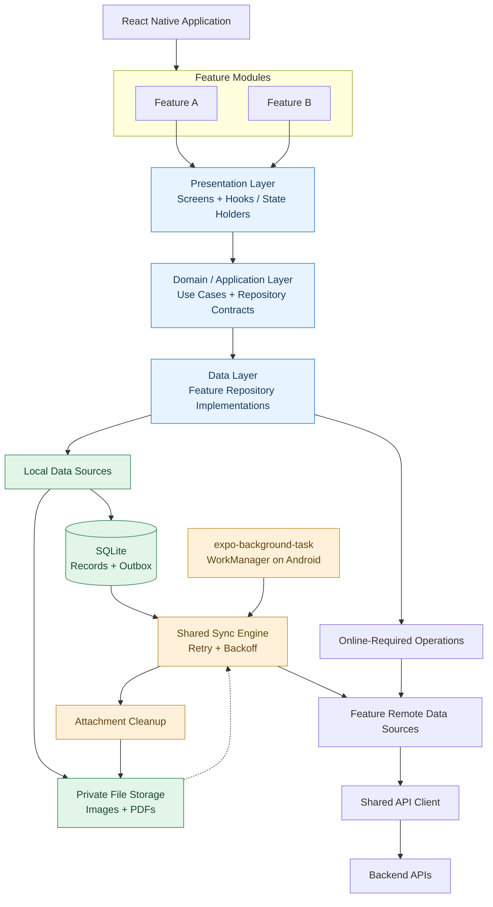

# Architecture — Keells FoS

Owns: architectural direction, the high-level diagram, application structure, folder responsibilities, and dependency rules.
Requirements, decisions, and open questions: [`project-context.md`](./project-context.md). Screen composition and styling: [`ui.md`](./ui.md). Conventions and quality practices: [`engineering-guide.md`](./engineering-guide.md).

## Proposed high-level design

Illustration only, not a build list. Feature names in the diagram are examples. Boxes such as SQLite and the sync engine are candidates (`project-context.md`). Background retry uses Expo `expo-background-task`, which uses WorkManager on Android; do not add WorkManager as a separate package. Do not create folders or a generic sync framework to match the diagram. Arrows are runtime flow. Import rules are below.



## Application structure

Status: **proposed default** (2026-11-01). Feature plans use this layout; confirm or adjust it with the first feature plan.

Create a folder only when it receives real files. Existing folders are marked.

```text
src/
├── app/                  # exists — Expo Router routes only
├── features/<feature>/   # with the first confirmed feature
│   ├── index.ts          #   public API of the feature
│   ├── ui/               #   screens, components, presentation hooks
│   ├── logic/            #   pure business rules
│   └── data/             #   remote calls and local persistence for the feature
├── shared/               # app-wide UI pieces, or when two or more consumers exist
│   ├── ui/               #   text, field, button, screen container; other shared components
│   └── lib/              #   pure utilities
└── infra/                # HTTP client, local database, secure storage, sync — when first needed
__tests__/                # exists — route-level tests
```

| Location | Responsibility | Must not contain |
|----------|----------------|------------------|
| `src/app/` | Route files and `_layout.tsx` navigators. A route reads params and renders a feature screen | Business rules, data access, tests, non-route helpers (every file is a route) |
| `src/features/<feature>/ui/` | Screens, feature components, hooks that hold presentation state and call the feature's logic and data | Direct HTTP or storage calls |
| `src/features/<feature>/logic/` | Validation, mapping, state transitions, and other rules as plain TypeScript | React, React Native, or I/O imports |
| `src/features/<feature>/data/` | The feature's API calls, local persistence, and mapping between server, storage, and domain shapes | UI code |
| `src/features/<feature>/index.ts` | What routes and other features may import | Re-exports of internals that nobody uses |
| `src/shared/ui/` | App-wide presentational pieces ([`ui.md`](./ui.md)), and presentational components used by two or more features | I/O, feature knowledge |
| `src/shared/lib/` | Pure utilities used by two or more features | I/O, feature knowledge |
| `src/infra/` | App-wide technical adapters with side effects, such as the HTTP client, local database, secure storage, configuration, logging, and later a sync coordinator | Feature-specific business rules |
| `__tests__/` | Route-level tests (Expo Router `renderRouter`) | Unit tests that can be colocated |

Within a small feature, files may start flat (`record-form.tsx`, `record-rules.ts`) and move into `ui/`, `logic/`, `data/` as the feature grows. The separation of roles matters more than the folders.

Mapping to the diagram: Presentation Layer → `ui/`; Domain / Application Layer → `logic/`; Data Layer → `data/`; local data sources, Shared API Client, and Shared Sync Engine → `src/infra/` once they exist. "Repository contracts" are introduced only when a real second implementation or test seam needs them.

## Dependency rules

| From | May import | Must not import |
|------|-----------|-----------------|
| `src/app/` | features (via `index.ts`), `shared/`, `infra/` (for providers in layouts) | feature internals |
| `features/<x>/ui/` | own `logic/` and `data/`, `shared/` | `infra/` directly (go through own `data/`) |
| `features/<x>/logic/` | `shared/lib/` | React, React Native, `data/`, `infra/` |
| `features/<x>/data/` | own `logic/` types, `infra/`, `shared/lib/` | `ui/` |
| `features/<x>/*` | `features/<y>/index.ts` only, when the dependency is justified | `features/<y>/` internals |
| `shared/` | `shared/` only | `app/`, `features/`, `infra/` |
| `infra/` | `shared/lib/` | `app/`, `features/` |

Enforcement: these rules are reviewed by the `reviewer` agent today. An ESLint `import/no-restricted-paths` rule and an `@/` import alias are deferred until `src/features/` exists (see [`project-context.md`](./project-context.md) decision log).

## Offline-capable workflows

Only actions that a feature spec classifies as offline-capable use local-first submission. Intended behavior, sync states, and duplicate-prevention concerns: [`project-context.md`](./project-context.md). The first offline-capable feature introduces the minimum local persistence and sync coordination it needs under `src/infra/`. Generalize only when a second feature needs the same mechanism.
